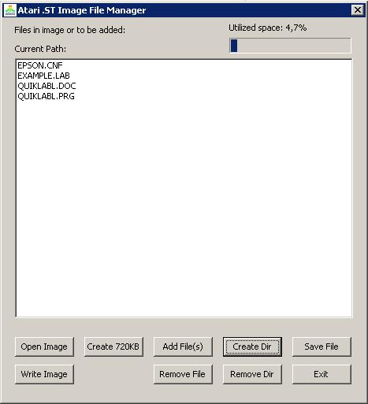

# Atari .ST & MSA File Manager



A Lazarus / Free Pascal project for managing and browsing Atari ST disk image files (`.st`, `.msa`).

## Build & Run Chain (Linux + Wine)

This project has been set up with an automated toolchain to compile for Windows Win32 and run under Wine on Linux without needing `sudo` or modifying system packages.

### Prerequisites
- **Wine** (installed at `/usr/bin/wine`)
- **Lazarus 32-bit for Windows** (installed at `~/.wine/drive_c/lazarus/`, configured with FPC 3.2.2 and Win32 LCL)

### Available Commands

#### 1. Compile the Windows Executable
```bash
./build.sh
# or
make
# or
make release
```
Builds `stimage.exe` (Release mode, optimized, symbols stripped).

#### 2. Compile in Debug Mode
```bash
./build.sh --debug
# or
make debug
```

#### 3. Run under Wine
```bash
./run.sh
```
Runs `wine stimage.exe` using your current X11 display session.

#### 4. Compile and Run in One Step
```bash
./compile_and_run.sh
# or
make run
```

#### 5. Clean Build Artifacts
```bash
./build.sh --clean
# or
make clean
```

### File List Indicators
- `*h*` — **Hidden File**: File has the FAT12 hidden attribute bit set (e.g. `R1PP3R.PRG *h*`).
- `*d*` — **Deleted File**: Existing deleted entry on disk (e.g. `_EADME.DOC *d*`). Can be restored using the **Undelete** button.
- `*A*` — **Pending Addition**: Staged file/directory to be written upon clicking "Write Image".
- `*D*` — **Pending Deletion**: File/directory marked for deletion upon clicking "Write Image".

### Atari ST Packer Detection & Depacking
STIMAGE includes a built-in Atari ST packer detection and decompression engine supporting 32+ packer formats and variants:
- **Pack-Ice** (v2.11, v2.31, v2.40, v3.0, etc.)
- **Atomik Cruncher** (v3.3, v3.4, v3.5, v3.6, ATM5)
- **Automation Packer** (v5.01, AU5!)
- **JAM Packer** (v4.0)
- **Rob Northen Compression / RNC ProPack** (Methods 1 & 2)
- **Thunder Packer** (v1.0 & v2.0)
- **JEK Packer / Bytekiller**
- **Degas Elite RLE Compressed Images** (`.PC1`, `.PC2`, `.PC3`)
- **Heuristic Signature Scanner** for embedded compressed streams

#### How to Use:
1. **In File Viewer / Hex Inspector**:
   - Double-click any file (or select and click **View File**).
   - If the file is compressed with a supported packer, the packer name and status are shown in the header.
   - Click **View Depacked** to decompress and inspect the depacked data in Hex or Text view (with automatic GEMDOS `$601A` executable header decoding).
   - Click **View Packed** to toggle back to the raw packed bytes.
   - Click **Save Depacked...** to save the decompressed file directly to host disk.
2. **From the Main Window**:
   - Select any file in the list and click **File -> Extract Depacked File...** to automatically detect, depack, and save to your computer in one step.

### Atari ST Picture Viewer
STIMAGE includes a built-in image viewer that detects and renders the most common Atari ST graphic formats:
- **DEGAS / DEGAS Elite**:
  - `.PI1` — Low Resolution (320x200, 16 colors from 512 palette)
  - `.PI2` — Medium Resolution (640x200, 4 colors, aspect-ratio corrected)
  - `.PI3` — High Resolution (640x400, monochrome)
  - `.PC1`, `.PC2`, `.PC3` — DEGAS Elite RLE Compressed images (automatically uncompressed on the fly)
- **NeoChrome**:
  - `.NEO` — 320x200 16-color images with animation palettes
- **Spectrum 512**:
  - `.SPU` — 320x200 512-color images rendered with dynamic per-scanline palettes
- **Raw Atari ST Screen Dumps**:
  - 32,000 / 32,032 bytes raw screens with embedded or default Atari ST system palette
- **Depacked Graphics**:
  - Files compressed with Pack-Ice, Atomik, JAM, etc. can be depacked with the **View Depacked** button and immediately inspected in Picture View!

#### Picture Viewer Features:
- **Instant Preview**: Double-clicking any recognized picture automatically opens it in **Picture View**.
- **Zoom Modes**: Click the **Zoom** button to toggle between:
  - `Zoom: 2x` (640x400 authentic display scaling)
  - `Zoom: 1x` (1:1 native pixel resolution)
  - `Zoom: Fit` (scale to window)
- **Export to Modern Formats**: Click **Save File...** while in Picture View to export the picture directly as a standard Windows 24-bit **`.BMP`** bitmap file or raw image.

### Undelete Feature
To recover a deleted file:
1. Select any file marked with `*d*` in the file list.
2. Click the **Undelete** button.
3. Enter the restored filename or missing first character in the dialog prompt.
4. The tool validates cluster availability in the FAT table, re-links the cluster chain, restores the directory entry, and refreshes the display.

---

### How the Toolchain Works
- **Wine Lazarus (`lazbuild.exe`)**: Builds the project using Free Pascal 3.2.2 with native Win32 LCL bindings.
- **GVFS / SMB Compatibility Layer**: Because GVFS SMB mounts don't support POSIX file locking required by Wine's intermediate compiler passes (e.g. `.res` resource writing), `build.sh` stages Pascal sources to a local temporary workspace (`/tmp/stimage_build_$USER`), maps it as Wine drive `T:`, compiles in ~1.5s, and syncs `stimage.exe` directly back to the project root.
